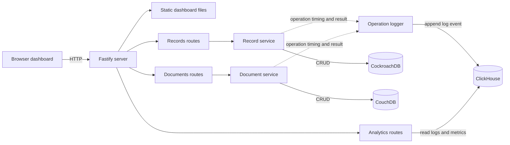

# DB Lab

A Fastify playground for CRUD operations across CockroachDB and CouchDB, with operation logs and analytics in ClickHouse. The browser dashboard is served by Fastify at `http://localhost:3000` by default.

## Stack

- **Fastify** serves the API and dashboard.
- **CockroachDB** stores relational records through Drizzle ORM.
- **CouchDB** stores JSON documents through Nano.
- **ClickHouse** stores operation logs and provides analytics.

## Architecture



## Why I built this

I built DB Lab to understand the strengths of different databases by using them in one small application. I wanted to practice relational CRUD with CockroachDB, flexible document CRUD with CouchDB, and use ClickHouse to capture each operation's duration, outcome, and error details. The dashboard lets me inspect those operations and compare how each database behaves in this setup.

## Requirements

- Node.js 18 or later (Nano 11 uses Node's built-in `fetch`).
- Yarn 4, as specified by `packageManager` in `package.json`.
- Docker Compose, if you want to run the databases from the included `compose.yaml`.

## Configure the environment

Create a `.env` file in the project root. Set the connection details to match the databases you use. For the included local Compose setup, the connection hosts and ports are:

```dotenv
PORT=3000

COCKROACH_HOST=127.0.0.1
COCKROACH_PORT=26257
COCKROACH_USER=root
COCKROACH_PASSWORD=
COCKROACH_DATABASE=dev

COUCHDB_URL=http://127.0.0.1:5984
COUCHDB_USER=admin
COUCHDB_PASSWORD=replace-with-a-local-password
COUCHDB_DATABASE=documents

CLICKHOUSE_URL=http://127.0.0.1:8123
CLICKHOUSE_USER=app
CLICKHOUSE_PASSWORD=replace-with-a-local-password
CLICKHOUSE_DATABASE=analytics
```

Use the same CouchDB and ClickHouse credentials in Compose and the app configuration. Keep real credentials out of source control.

## Start the databases and app

Install dependencies and start the database containers:

```bash
yarn install
docker compose up -d
```

The Compose file starts CockroachDB in insecure single-node mode for local development. Create the database named by `COCKROACH_DATABASE` if it does not already exist. With the default above:

```bash
docker compose exec cockroachdb cockroach sql --insecure --execute="CREATE DATABASE IF NOT EXISTS dev"
```

Apply the CockroachDB schema migration, then start the app:

```bash
yarn db:migrate
yarn dev
```

`yarn start` runs the app without Node's file watcher. At startup, the app authenticates with CouchDB and creates the configured CouchDB database if needed. It also creates the ClickHouse `operation_logs` table. The app exits with an error if either initialization fails. CockroachDB migrations are a separate step and are not run automatically.

Open [http://localhost:3000](http://localhost:3000) to use the dashboard. Set `PORT` to use a different port.

## Dashboard

- **Overview** shows recent operation logs and summary metrics from ClickHouse.
- **CockroachDB** supports create, list, read, update, and delete for records.
- **CouchDB** supports create, list, read, update, and delete for documents.
- **ClickHouse Logs** shows operation history, summaries, and slow operations.

## API routes

### Records — CockroachDB

| Method | Route | Purpose |
| --- | --- | --- |
| `POST` | `/api/records` | Create a record (`name`, `email`, optional `description`) |
| `GET` | `/api/records` | List records |
| `GET` | `/api/records/:id` | Read one record |
| `PATCH` | `/api/records/:id` | Update supplied record fields |
| `DELETE` | `/api/records/:id` | Delete a record |

CockroachDB `SERIAL` IDs may be 64-bit values. Keep IDs as strings when using route URLs; converting them to JavaScript numbers can lose precision. The API validates the decimal ID string and passes it to the database without rounding.

### Documents — CouchDB

| Method | Route | Purpose |
| --- | --- | --- |
| `POST` | `/api/documents` | Create a document (`title`, optional `content`, `category`, `tags`) |
| `GET` | `/api/documents` | List documents |
| `GET` | `/api/documents/:id` | Read one document |
| `PATCH` | `/api/documents/:id` | Update supplied document fields |
| `DELETE` | `/api/documents/:id` | Delete a document |

### Analytics — ClickHouse

| Method | Route | Purpose |
| --- | --- | --- |
| `GET` | `/api/analytics/logs` | List logs; optional `limit`, `database`, and `status` query parameters |
| `GET` | `/api/analytics/summary` | Counts and duration metrics grouped by database and operation |
| `GET` | `/api/analytics/slowest` | Slowest operations; optional `limit` query parameter |

CRUD operations are timed and logged to ClickHouse. A logging failure is reported in the server log and does not replace the CRUD response.

## Database scripts

```bash
yarn db:generate  # Generate a CockroachDB migration from schema changes
yarn db:migrate   # Apply pending CockroachDB migrations
yarn db:studio    # Open Drizzle Studio
```

## Project layout

```text
db/                 Database clients, schema, and CockroachDB migrations
services/           CRUD and database operation logic
routes/             Fastify API routes
utils/              Shared operation logger
public/             Browser dashboard assets
server.js           Fastify setup and database initialization
compose.yaml        Local CockroachDB, CouchDB, and ClickHouse services
drizzle.config.js   Drizzle Kit configuration for CockroachDB
```
